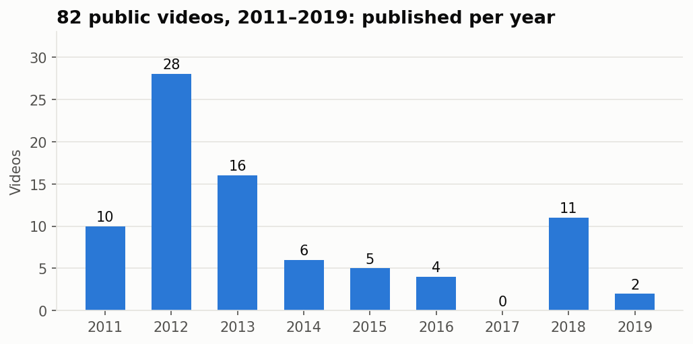

# Stage 2: Data

## Where the data comes from
My own channel's analytics, exported from **YouTube Studio → Analytics → Advanced mode → Content**:

| Export | Date range | What it gives |
|---|---|---|
| Lifetime | Aug 2011 → Oct 2026 | Every metric, all-time, per video |
| Active years | Aug 2011 → Dec 2019 | The same metrics, only for the years I was posting |

Comparing the two shows how many views each video earned **after I stopped posting** (question 6).

## Privacy first
The channel isn't named anywhere in this project. Titles and YouTube IDs are replaced with `V001`, `V002`…
by [`build_dataset.py`](build_dataset.py), and the raw exports never leave my computer.

## Files
| File | What it is |
|---|---|
| [`build_dataset.py`](build_dataset.py) | Combines the two exports and anonymizes them |
| [`videos_anonymized.csv`](videos_anonymized.csv) | The dataset: 337 videos × 18 columns |
| [`data_dictionary.md`](data_dictionary.md) | What every column means, plus control totals |
| [`profile_data.py`](profile_data.py) | First-look profile and overview chart |

## First look



```
Videos in export:                 337
  with a publish date:            89
    published Aug 2011-Dec 2019:  82   ← the analysis scope
    published after 2019:         7
  no publish date (mostly unlisted): 248

Lifetime views, all videos:       542,456
  from in-scope videos:           532,733 (98.2%)
```

**The headline:** 337 videos looked like a lot, but only **82 are public videos from my active years**.
Those 82 hold **98% of all views**, so they're what the analysis is really about.

## Data quality issues found → fixed in Stage 3

| # | Issue | Rows | Plan |
|---|---|---|---|
| 1 | No publish date: mostly unlisted videos | 248 | Keep but flag as out of scope |
| 2 | Published after 2019 (outside the active years) | 7 | Flag as out of scope |
| 3 | `publish_date` and `avg_view_duration` stored as text | all | Convert to a real date and to seconds |
| 4 | `avg_pct_viewed` over 100% | 94 | Real (viewers looping short animations), so keep it and explain it |
| 5 | One video with no metrics at all | 1 | Investigate, likely drop |
| 6 | `ctr_pct` blank when a video had no impressions | 48 | Leave blank; don't treat it as 0% |
| 7 | Impressions only counted since YouTube began tracking them | old videos | Don't compare CTR across years |
| 8 | No "content type" column | all | Create content categories (Stage 3) |
