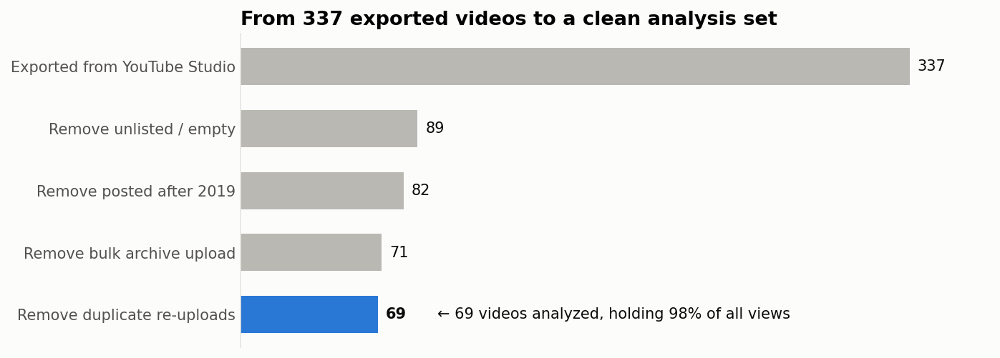

# Stage 3: Clean

## The approach
- **Flag, don't delete.** All 337 videos stay in [`videos_clean.csv`](videos_clean.csv). Videos that shouldn't be
  analyzed get `in_analysis = 0` and an `exclude_reason`, so every number traces back to the original export.
- **Every rule is logged** with *why* and *how many rows* it touched, in [`cleaning_log.md`](cleaning_log.md),
  which [`clean.py`](clean.py) rebuilds every time it runs.
- **Validation checks must pass**, or the script stops. Total views before and after cleaning must match exactly.

## What changed
| Problem | Fix |
|---|---|
| Dates and durations stored as text | Converted to real dates and seconds |
| No content type in the export | Each public video given a category (see below) |
| 247 unlisted videos + 1 empty row | Flagged out of scope (~1% of views) |
| 7 videos posted after 2019 | Flagged out of scope |
| **2 duplicate re-uploads**: same video posted twice on the same day | Kept the copy with more views, flagged the other, so nothing is counted twice |
| **11 videos uploaded on one day in 2018** | Flagged as a bulk archive upload of old clips, not regular releases |
| Retention over 100% on 94 videos | **Kept.** Viewers were looping short animations. That's real behaviour, not an error |
| CTR blank when there were no impressions | **Left blank**, because 0% would be wrong |

## Content categories
The export has no "type of video" column, so I assigned one from the original titles (done privately so titles
stay off GitHub). The result is in [`content_categories.csv`](content_categories.csv).

| Category | What it means | Videos in analysis |
|---|---|---|
| Comedy shorts & skits | Short animated jokes and skits | 25 |
| Gameplay & let's play | Recorded gameplay footage | 14 |
| Music animation | Sprite animations set to music | 13 |
| Tests & throwaway clips | Experiments, tests, unfinished bits | 9 |
| Story animation | Longer story-driven sprite animations | 6 |
| Prank calls | Audio prank-call videos | 2 |

## Result
**69 videos** are in the analysis. They hold **530,538 views, 98% of the channel's total.** All 7 validation checks pass.

## New columns for Stage 4
`publish_year`, `publish_weekday`, `length_bucket`, `avg_view_sec`, `is_looped`, per-1,000-view rates
(`subs_gained_per_1k_views`, `likes_per_1k_views`, …), `views_after_2019`, `long_tail_pct`.
