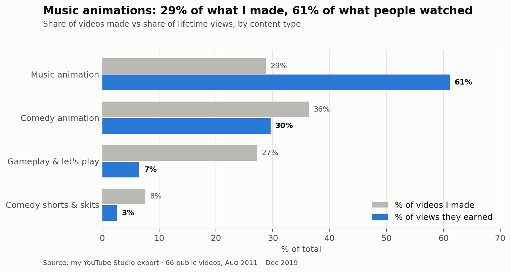
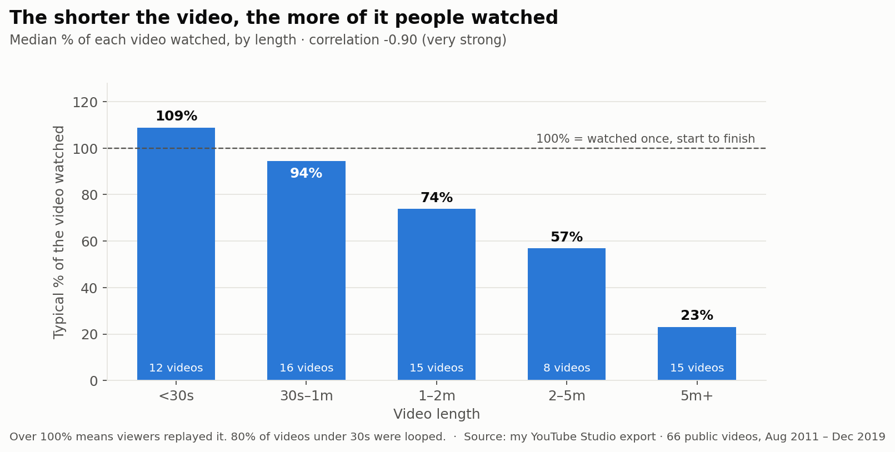
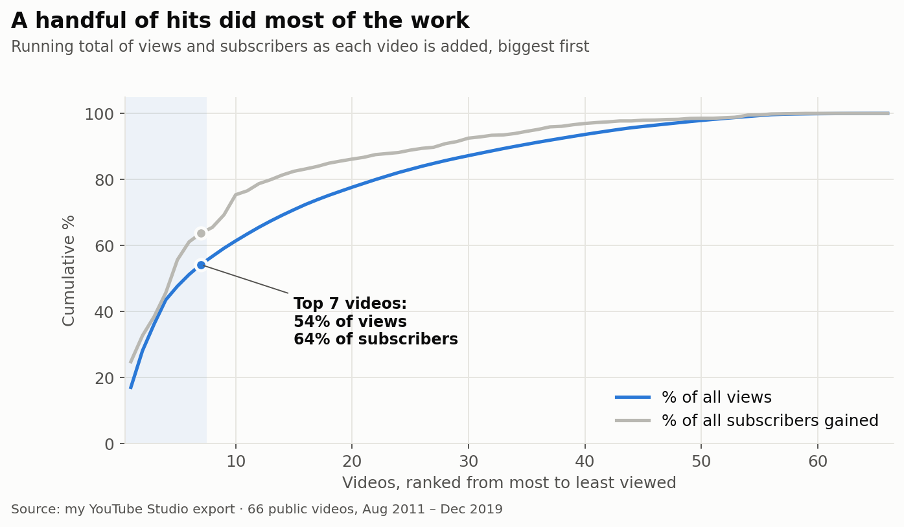
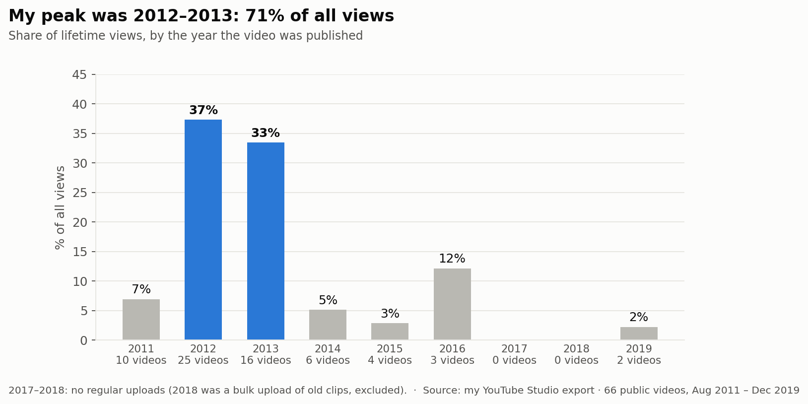
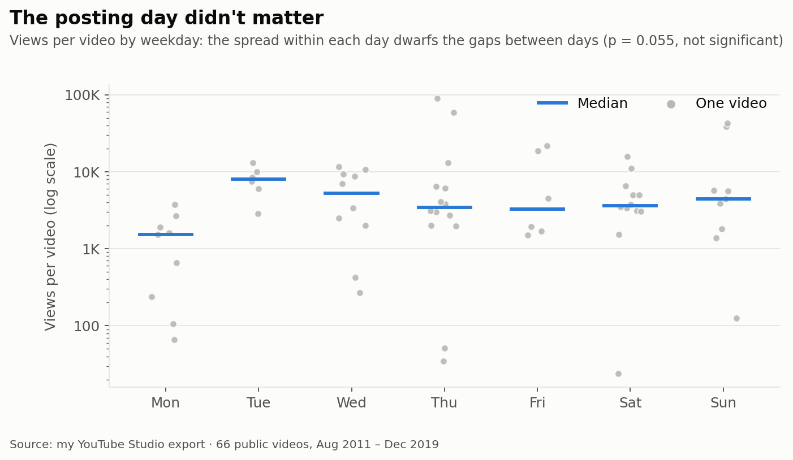
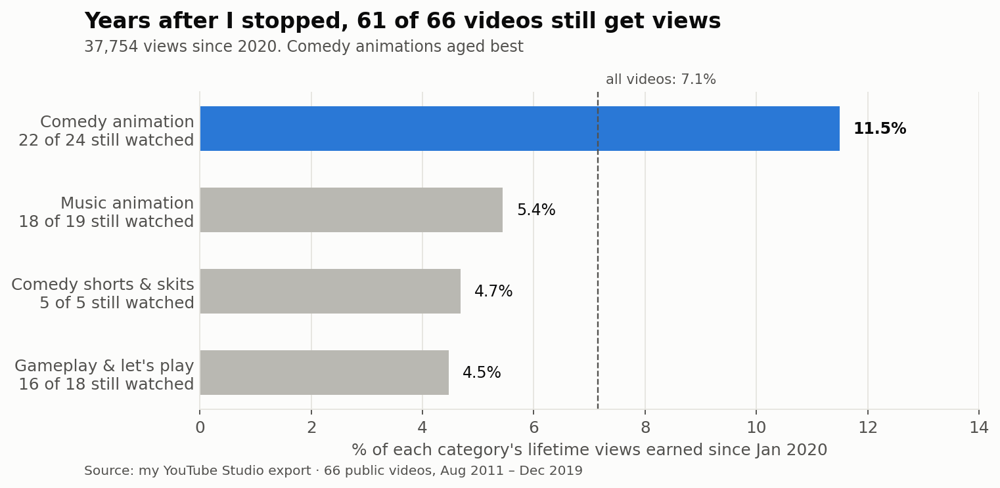

# Stage 5: Visualize

One chart per question. Every title **states the finding**, not just the topic, so each chart makes sense on its own.
All charts are generated by [`make_charts.py`](make_charts.py) from the clean data. Re-run it and they rebuild.

**Design rules used throughout:** blue = the point of the chart, gray = context · direct labels instead of
making you read the axis · sample sizes shown wherever a group is small · medians where viral videos would skew averages.

---

### 01 · Content: what I made vs what people watched

### 02 · Length: shorter videos held attention

### 03 · Engagement: a few hits did most of the work

### 04 · Growth: the peak came early

### 05 · Timing: the posting day didn't matter

*Why a dot plot here:* a bar chart of averages would make Tuesday look like the "best day". Showing every video
makes it obvious that the spread *within* each day is far bigger than the gaps *between* days.

### 06 · Long tail: still watched years later

