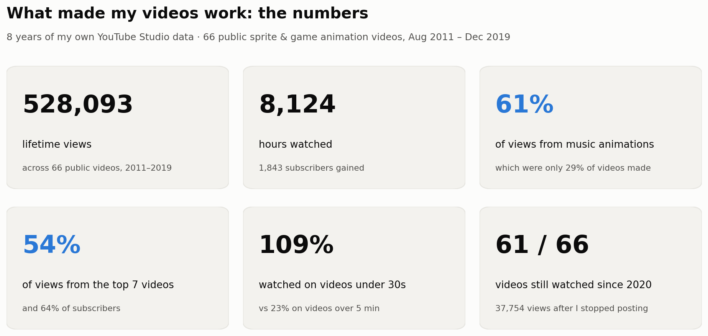
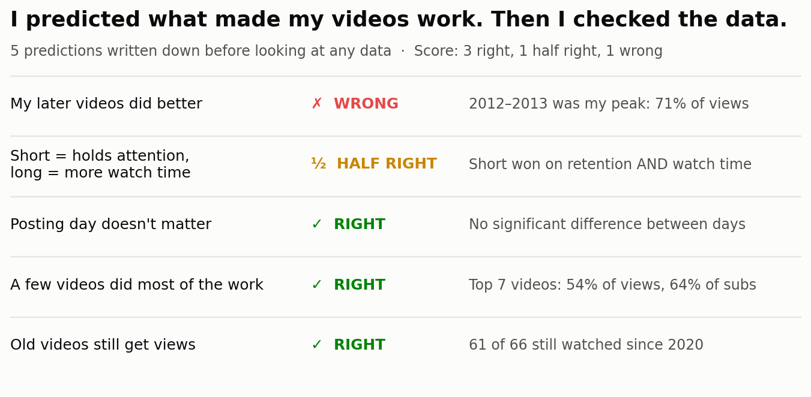

# Stage 6: Final Report

## The question
> *"What made some of my videos take off while others didn't, and what would I do differently if I started again?"*

## Executive summary
I analyzed **66 public sprite and game animation videos** from my own YouTube channel (Aug 2011 – Dec 2019),
using real YouTube Studio data: **528,000+ views, 8,100+ hours watched, 1,800+ subscribers**.

**The short answer: short music animations.** They were less than a third of what I made but earned most of
the views and subscribers. Length mattered enormously, the posting day didn't matter at all, and a handful of
hits did most of the work. My biggest wrong assumption was that I kept getting better. The data says my peak came early.

---

## Findings

| # | Finding | Evidence | Chart |
|---|---|---|---|
| 1 | **Music animations carried the channel** | 29% of videos → **61% of views**, 69% of subscribers | [01](../5_Visualize/charts/01_content_made_vs_watched.png) |
| 2 | **Gameplay was the biggest mismatch** | 27% of videos → only **7% of views**; viewers watched ~32% of each | [01](../5_Visualize/charts/01_content_made_vs_watched.png) |
| 3 | **Shorter videos held attention, and still won on views** | Under 30s: **109%** watched (replays); over 5 min: **23%**; correlation −0.90 | [02](../5_Visualize/charts/02_length_vs_retention.png) |
| 4 | **A few hits did most of the work** | Top 7 videos (10%) → **54% of views, 64% of subscribers** | [03](../5_Visualize/charts/03_few_hits_did_most_work.png) |
| 5 | **The peak came early** | 2012–2013 videos → **71% of all views** | [04](../5_Visualize/charts/04_peak_was_2012_2013.png) |
| 6 | **Posting day didn't matter** | No statistically reliable difference (p = 0.055) | [05](../5_Visualize/charts/05_posting_day_didnt_matter.png) |
| 7 | **The catalogue keeps working** | **61 of 66** videos still get views; 37,754 since 2020 | [06](../5_Visualize/charts/06_still_watched_years_later.png) |

## Predictions vs reality

The one I got wrong is the most useful: I assumed my later work was my best work. The audience disagreed.
**Your own sense of "better" and your audience's aren't always the same thing, and that's exactly why you check the data.**

---

## Recommendations: if I restarted the channel today

| # | Do this | Because |
|---|---|---|
| 1 | **Lead with short music animations** | My proven format: 29% of output → 61% of views and 69% of subscribers |
| 2 | **Keep videos between 30 seconds and 2 minutes** | Retention falls steadily with length, and short videos *also* won on views and watch time |
| 3 | **Make them loopable, and publish them as Shorts** | 80% of my sub-30s videos were replayed (>100% watched). That loop behaviour is exactly what short-form feeds reward today |
| 4 | **Cut gameplay, or treat it as a side project** | 27% of my effort earned 7% of my views and converted the fewest subscribers |
| 5 | **Stop worrying about posting day** | No measurable effect. Time is better spent on the video itself |
| 6 | **Plan for hits, not averages** | 10% of videos drove most growth. Make more attempts in the winning format rather than polishing one long video |

## What this means beyond my channel
The same questions apply to any team that publishes content (social, marketing, product education):
- **Compare effort to outcome.** What share of output goes to each format, vs what share of results it earns?
  My 27% → 7% gameplay gap was invisible until I put the two numbers side by side.
- **Use medians and distributions, not averages.** One viral post makes an average lie. The "best posting day"
  disappears once you look at every post instead of the mean.
- **Separate hit-driven formats from consistent ones.** Music animations had the biggest hits, while comedy animations
  had the highest *typical* views. Both are useful, for different goals.

## Limitations
- **66 videos is a small sample.** Strong patterns (length, content type) are clear. Smaller splits (weekday, single years) are thin.
- **Correlation, not causation.** Length and content type overlap (most short videos were animations), so I can't fully separate their effects.
- **Lifetime totals favour older videos**, which have had more time to collect views.
- **The platform changed.** YouTube's algorithm in 2012 isn't YouTube's algorithm in 2019.
- **Categories were assigned by me**, as the creator, from titles and memory.

## What I'd do next as an analyst
1. **Compare videos on their first 30 days**, using YouTube's daily data, so old and new videos are judged fairly.
2. **Build a regression model** to separate the effect of *length* from the effect of *content type*.
3. **Add traffic sources** (search vs suggested vs external) to see *how* the hits were found.

---

## How this project was built
| Stage | What I did | Skills |
|---|---|---|
| [1. Idea](../1_Idea/project_brief.md) | Business question, KPIs, scope, predictions written in advance | Problem framing |
| [2. Data](../2_Data/README.md) | Exported and combined two YouTube Studio reports, anonymized, data dictionary, control totals | Data sourcing, privacy |
| [3. Clean](../3_Clean/README.md) | 12 logged cleaning rules, flag-don't-delete, 7 validation checks | Python, pandas, data quality |
| [4. Analyze](../4_Analyze/README.md) | Six questions answered in Python and cross-checked in SQL, significance tests | SQL, statistics |
| [5. Visualize](../5_Visualize/README.md) | Six charts, each titled with its finding | matplotlib, data storytelling |
| **6. Report** | KPIs, findings, recommendations, limitations | Communication |
