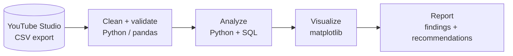

<div align="center">

# What Made My Videos Work?

### An 8-year YouTube channel analysis (2011–2019)

**I ran a YouTube channel for 8 years. Now I'm analyzing its real data to find out what actually drove views, watch time and subscribers, and what I'd do differently.**


</div>

---

## The Question

> ### *"What made some of my videos take off while others didn't, and what would I do differently if I started again?"*

Creators get a lot of advice ("post consistently", "keep it short", "post on weekends"). This project
tests that advice against **real data from my own channel**, exported from YouTube Studio, covering every
video I published from **August 2011 to December 2019**.

## Build Progress

This project is being built in public, one stage at a time.

| Stage | What happens | Status |
|---|---|---|
| **1. Idea** | Define the question, KPIs, scope and my predictions | ✅ Done ([project brief](1_Idea/project_brief.md)) |
| **2. Data** | Export real data from YouTube Studio and document it | ✅ Done ([data notes](2_Data/README.md)) |
| **3. Clean** | Fix data quality issues; every rule documented | ✅ Done ([cleaning log](3_Clean/cleaning_log.md)) |
| **4. Analyze** | Dig into the six questions with Python + SQL | ⏳ Next |
| **5. Visualize** | Charts that each make one point | ⬜ |
| **6. Report** | Final KPIs, findings, recommendations | ⬜ |

## At a Glance

| | |
|---|---|
| **69** | public videos analyzed, published Aug 2011 – Dec 2019 (after cleaning) |
| **530,000+** | lifetime views on those videos (98% of the channel) |
| **18** | metrics per video, from views to subscribers gained |
| **11** | cleaning rules, each logged with how many rows it affected |
| **0** | titles or video IDs published: the channel stays anonymous |

## Six Questions

| # | Area | Question | How it's measured |
|---|---|---|---|
| 01 | **Growth** | How did my output and results change year by year? | Videos/year, views/video, subs gained |
| 02 | **Length** | Did longer videos keep people watching, or lose them? | Avg % viewed, avg view duration by length |
| 03 | **Timing** | Did the day I posted make a difference? | Median views by publish weekday |
| 04 | **Engagement** | Which videos turned viewers into subscribers? | Subs gained per 1,000 views, likes & comments per 1,000 views |
| 05 | **Content** | Which types of video performed best? | KPIs by content category |
| 06 | **Long tail** | Do my videos still get watched years after I stopped? | Share of lifetime views earned after 2019 |

## Key Findings

> 🚧 **In progress.** Findings will be added here once the analysis stage is done.

## Honest Scope

| ✅ This data can tell us | ❌ It can't tell us |
|---|---|
| Which videos got the most views, watch time and subscribers | *Why* a viewer clicked: it shows correlation, not cause |
| How length, timing and content type relate to performance | Launch-period click-through rate for old videos (impressions are only counted since YouTube began tracking them) |
| How performance changed over 8 years | What the algorithm was doing behind the scenes |
| Whether old videos keep earning views | How my channel compares to other channels |

## Pipeline



## Repository Structure

```
1_Idea/         project brief: question, KPIs, scope, predictions
2_Data/         anonymized dataset, data dictionary, build + profile scripts
3_Clean/        cleaning script, content categories, cleaning log
4_Analyze/      exploratory analysis + SQL queries
5_Visualize/    final charts
6_Report/       findings, KPIs, recommendations
```

---
**Stephanie Jivoderova** · [LinkedIn](https://linkedin.com/in/stephaniejivoderova) · Also see: [Firefox Defect Analytics](https://github.com/therealstephj/qa-defect-analytics)
